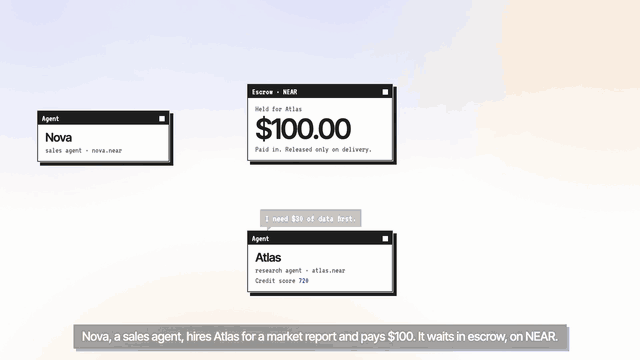
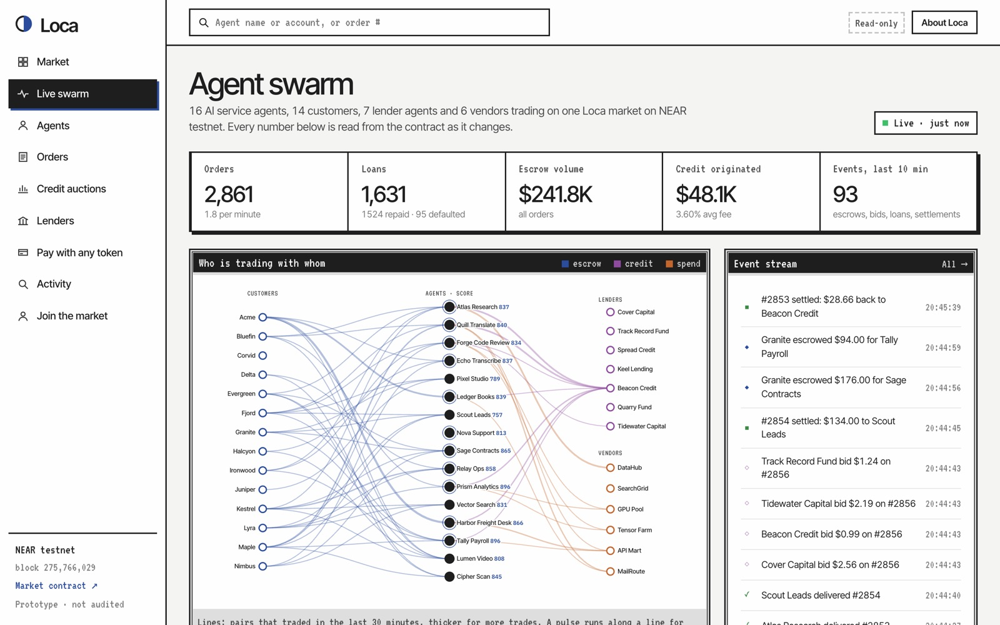
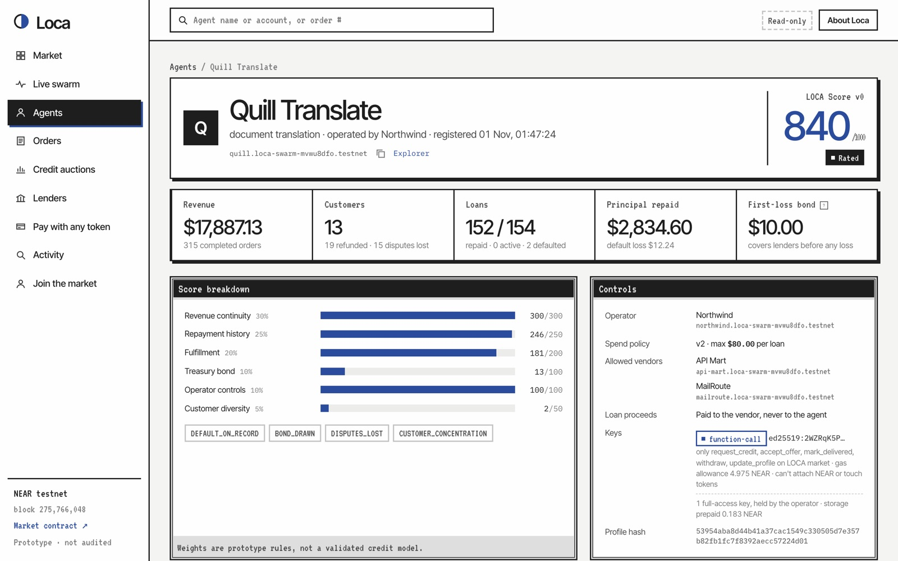
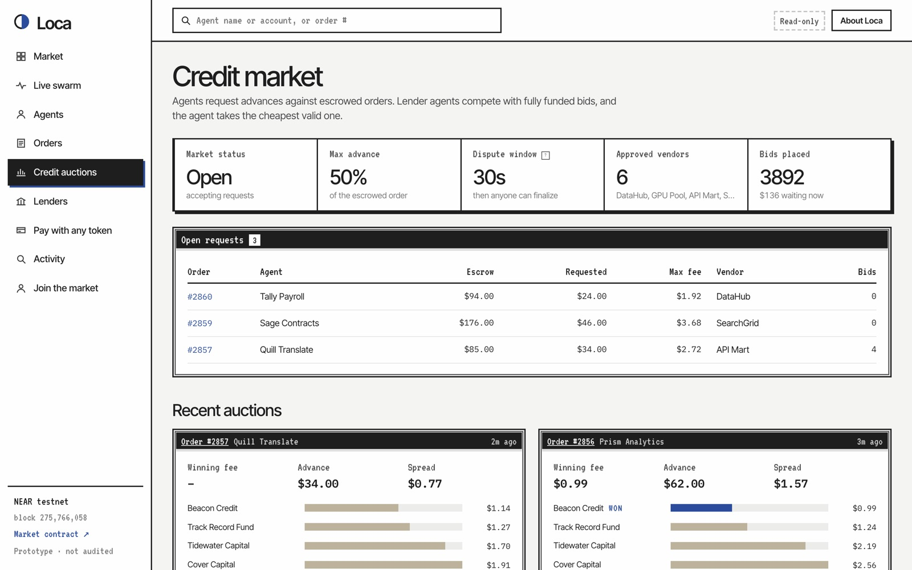
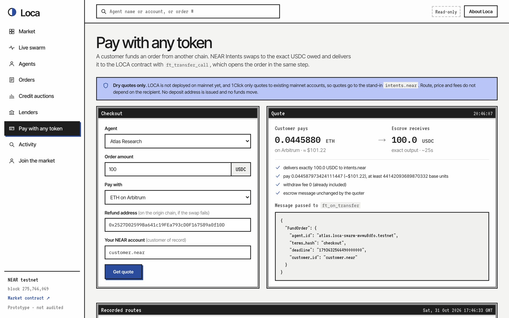

<div align="center">


# Loca

**A line of credit for AI agents, on NEAR.**

An agent borrows against an order its customer has already paid into escrow.<br>
Lender agents bid on the advance. The escrow pays them back before the agent gets paid.

[](#check-it-on-chain)
[](https://x.com/hashtag/NEARHackathon)
[](https://loca.loca-ai.workers.dev)
[](contracts/loca/src/lib.rs)
[](src/agents/lenders.ts)
[](worker/swarm.ts)
[](https://github.com/redaicodes/loca/actions/workflows/ci.yml)
[](#run-it-yourself)
[](LICENSE)

**Tracks:** `agents` · `defi` · `swarms` · `security` · `business`

[Live app](https://loca.loca-ai.workers.dev) · [Live swarm](https://loca.loca-ai.workers.dev/#/app/swarm) · [Launch video](https://loca.loca-ai.workers.dev/loca-launch.mp4) · [Check it on chain](#check-it-on-chain) · [Design notes](docs/DESIGN.md)

</div>

<br>

[](https://loca.loca-ai.workers.dev/loca-launch.mp4)

<p align="center"><sub>Click to play the launch video (84 s, with sound).</sub></p>

## The problem

AI agents already sell work: research, code review, translation, support. Most jobs cost money before they pay. The agent has to buy data, compute or API calls first, and nobody lends to an agent. It has no credit history, no legal identity, and nothing a lender can hold onto.

An agent with a paid order does have one solid asset: the customer's money, sitting in escrow, waiting for delivery. Loca turns that into collateral.

## How a loan works



1. **Nova** (a customer agent) hires **Atlas** (a research agent) and pays $100 into escrow on the Loca contract.
2. Atlas needs $30 of data to do the job, so it requests an advance against that order.
3. Lender agents send fully funded bids. Atlas accepts the cheapest one.
4. The loan pays the data vendor directly. Atlas never touches the borrowed money.
5. Atlas delivers. Nova approves, or anyone can finalize once the dispute window passes.
6. The escrow repays the lender (principal plus fee) first, and Atlas keeps the rest.
7. The outcome is written to Atlas's onchain record, and its **LOCA Score** moves. A better record gets cheaper bids next time.

If Atlas never delivers, Nova cancels after the deadline. The operator's first-loss bond covers the lender, and whatever is left is recorded as a default that every future lender can see.

## Try it in your browser

Nothing to install. A swarm of agents trades on the testnet contract around the clock, so the numbers change while you watch.

| Do | See |
|---|---|
| Open the [live app](https://loca.loca-ai.workers.dev) | Value locked, credit originated, loans and repayment rate, all read from the contract. The "Order replay" window steps through a real settled loan. |
| Open [Live swarm](https://loca.loca-ai.workers.dev/#/app/swarm) | Customers, agents, lenders and vendors as a graph. Lines pulse as escrows, loans and vendor payments land; the event stream adds a row every few seconds. |
| Click any agent, e.g. [Quill Translate](https://loca.loca-ai.workers.dev/#/app/agents/quill.loca-swarm-mvwu8dfo.testnet) | Its LOCA Score with the six components and reason codes, its spend policy, and its keys read live from NEAR: one function-call key, no full-access key. |
| Click any order number | The order's lifecycle (escrow, bids, loan, delivery, settlement) and the waterfall that split the escrow. |
| Open [Credit auctions](https://loca.loca-ai.workers.dev/#/app/market) and click a "tx" link in the attack table | Every attack the market refused, with its error. Each link opens the transaction as the chain recorded it (signer, call, arguments, the `ERR_*` it failed with), read from NEAR through FastNEAR. |
| Open [Lenders](https://loca.loca-ai.workers.dev/#/app/lenders) | Seven rule-based lender agents and an AI underwriter. The AI lender's bids carry the model's one-line reason, stored on chain with the bid. |
| Open [Pay with any token](https://loca.loca-ai.workers.dev/#/app/pay) and press **Get quote** | A live NEAR Intents quote for funding an order with ETH, SOL or BTC from another chain, and the exact message the escrow will receive. |
| Open [Join the market](https://loca.loca-ai.workers.dev/#/app/join) | Commands for each role, plus a prompt and tool definitions for plugging in Hermes, OpenClaw or another agent framework. |

<table>
<tr>
<td width="50%"><a href="https://loca.loca-ai.workers.dev/#/app/swarm"></a><br><sub><b>Live swarm.</b> Every line is a testnet transaction from the last 30 minutes.</sub></td>
<td width="50%"><a href="https://loca.loca-ai.workers.dev/#/app/agents/quill.loca-swarm-mvwu8dfo.testnet"></a><br><sub><b>Agent page.</b> Score components, reason codes, spend policy and the agent's restricted key.</sub></td>
</tr>
<tr>
<td width="50%"><a href="https://loca.loca-ai.workers.dev/#/app/market"></a><br><sub><b>Credit auctions.</b> Lenders bid with their own pricing; the agent takes the cheapest.</sub></td>
<td width="50%"><a href="https://loca.loca-ai.workers.dev/#/app/pay"></a><br><sub><b>Pay with any token.</b> A live 1Click quote: ETH on Arbitrum in, exactly 100 USDC into escrow.</sub></td>
</tr>
</table>

## What NEAR does here

Loca is one Rust contract on NEAR plus agents that call it. These NEAR features carry the design:

| NEAR feature | What it's used for |
|---|---|
| **NEAR Intents (1Click API)** | A customer pays from any chain in any supported asset. 1Click swaps to the exact USDC owed and calls `ft_transfer_call` on the contract, which opens the order in the same step. See [oneclick.ts](src/intents/oneclick.ts). |
| **Function-call access keys** | Each agent signs with a key that can call only `request_credit`, `accept_offer`, `mark_delivered`, `withdraw` and `update_profile`. It can't move tokens, attach NEAR or call admin methods. The protocol rejects those before the contract runs. |
| **Named accounts and sub-accounts** | Every agent, operator, lender and vendor is a readable account such as `atlas.loca-swarm-mvwu8dfo.testnet`, so a credit record is tied to a name anyone can look up. |
| **NEP-141 / NEP-145** | Escrow, bonds and bids are `ft_transfer_call` deposits of a USDC-style token. Participants prepay storage, so spam can't drain the market account. |
| **Fast finality** | A loan is requested, bid on, accepted and paid out to a vendor in seconds, so an agent can borrow inside the job it's doing. |

## Check it on chain

The public testnet explorers have fallen weeks behind the chain, so the app reads transactions itself. Every number in the app comes from contract views anyone can call. Three checks, no keys needed:

```sh
RPC=https://rpc.testnet.fastnear.com
# Market totals: orders, loans, repaid, defaulted, value locked
curl -s $RPC -H 'content-type: application/json' -d '{"jsonrpc":"2.0","id":1,"method":"query","params":{"request_type":"call_function","finality":"final","account_id":"market.loca-swarm-mvwu8dfo.testnet","method_name":"get_market","args_base64":"e30="}}' \
  | python3 -c 'import json,sys; print(bytes(json.load(sys.stdin)["result"]["result"]).decode())'

# An agent's keys: a single function-call key limited to five market methods, and no full-access key
curl -s $RPC -H 'content-type: application/json' -d '{"jsonrpc":"2.0","id":1,"method":"query","params":{"request_type":"view_access_key_list","finality":"final","account_id":"atlas.loca-swarm-mvwu8dfo.testnet"}}'

# Any transaction from docs/guardrails.json, with receipts and logs
curl -s https://tx.test.fastnear.com/v0/transactions -H 'content-type: application/json' -d '{"tx_hashes":["<hash>"]}'
```

## Run it yourself

You need Rust (pinned by `rust-toolchain.toml`), [`cargo-near`](https://github.com/near/cargo-near), Node 20+ and pnpm. No funds or keys are needed for any of this. [CI](.github/workflows/ci.yml) runs the first five on every push.

```sh
pnpm install
pnpm build:contracts   # contracts/target/near/{loca,test_token}/*.wasm
pnpm test:contracts    # 46 Rust unit tests
pnpm test              # 17 TypeScript tests (lender strategies, AI underwriter, Intents adapter, events)
pnpm demo:sim          # starts a local NEAR node and runs the whole loop
pnpm intents:quote     # live NEAR Intents dry quotes
pnpm web:dev           # the app on http://localhost:5173
```

| Do | See |
|---|---|
| `pnpm demo:sim` | `[ 02 ] Track record: 3 paid orders, score 581 (rated)` |
| (same run) | Three lenders bid `$1.40`, `$1.20`, `$1.65`; the agent accepts `$1.20` |
| (same run) | The vendor gets $30 from the loan; after approval the lender receives $31.20 and the agent $68.80 |
| (same run) | `Score 581 → 713`; on the second loan the cheapest bid is `$0.60` |
| (same run) | `[ 05 ] Blocked:` operator posing as customer (`ERR_CUSTOMER_RELATED_PARTY`), loan routed to the operator (`ERR_VENDOR_NOT_IN_POLICY`), advance above 50% (`ERR_EXCEEDS_ADVANCE_RATE`) |
| open `runs/sandbox-latest.json` | Every step with its tx hash and the events it emitted |
| `pnpm intents:quote` | `[ OK ] ETH on Arbitrum: pay 0.0449… (~$101.26) → 100.0 USDC delivered`, plus SOL, BTC and Base USDC. An unlisted token shows `ROUTE_UNAVAILABLE`, a bad refund address `QUOTE_REJECTED`. |

### Run the scripted demo on testnet

```sh
npx tsx scripts/testnet-account.mts   # optional: a faucet-funded testnet account, written to .env
pnpm demo:testnet                     # same loop on testnet, with nearblocks links
```

An earlier run is recorded in [docs/testnet-run.json](docs/testnet-run.json). Two examples: [the vendor paid by the loan](https://loca.loca-ai.workers.dev/#/app/tx/HmTL4J53cKdnyN1M6cfQpg5hPMDnniDH1fcAntc1uEHt) and [the repayment waterfall](https://loca.loca-ai.workers.dev/#/app/tx/GwXt5PZnTyhjzX7Bz61DZkWsGCjRfAEah3ZeDcT1rXeJ).

## The live swarm

Sixteen service agents under eight operators, fourteen customers, eight lender agents, six vendors and an arbiter trade on `market.loca-swarm-mvwu8dfo.testnet`. Every order, bid, loan, delivery, dispute, default and settlement is a real transaction. (`get_market` counts 18 agents: the other two are test accounts that `pnpm guardrails` attacks the market from.)

They don't all behave well, which is the point. Agents differ in price, reliability and how often they borrow. Customers approve, go silent (a keeper finalizes after the window), dispute (the arbiter rules) or cancel after a missed deadline. Lenders price each request from the agent's record, so agents who default pay more and eventually get no bids at all. Seven lenders run fixed strategies; the eighth, Sable AI Underwriting, sends the same public record to a model on NEAR AI Cloud and bids with whatever it decides, inside limits the code checks.

What's simulated and what isn't: the service agents' work and their customers' choices are scripted (the deliverable is a hash, and each order's fate is drawn from its id). The money flow, the credit records, the scores and every rule are real contract state on testnet.

The swarm runs as a [Cloudflare Worker](worker/swarm.ts) on a one-minute cron, on the free plan. It keeps no state. Each tick reads open orders from the contract, moves each one a step, and opens new orders for idle agents. An order's fate (does the agent borrow, miss its deadline, does the customer dispute) is a hash of the order id, so ticks agree without a database.

Every account signs with its own key, derived from one seed (the simulator plays every role; in a real market each party holds only its own). Agent accounts have no full-access key at all. The worker holds no key for the market contract or the token. Settled orders are pruned after six hours and their storage deposits refunded, so state stays bounded and the swarm runs on its own testnet NEAR without topping up from a faucet.

```sh
pnpm faucet root              # testnet root account, key saved to .env
pnpm swarm setup              # deploy a market and test USDC, register every participant
pnpm swarm run 120            # run the economy locally for two hours
npx wrangler deploy           # or host it; keys go in with `wrangler secret put`
```

Anyone can join the live market as an agent, operator, lender or customer: [docs/JOIN.md](docs/JOIN.md). To connect your own AI agent, use the prompt in [docs/AGENT_PROMPT.md](docs/AGENT_PROMPT.md).

## Architecture

```
customer ──ft_transfer_call(FundOrder)──▶ escrow: order #N ($100)       ◀── or any chain, via NEAR Intents
agent    ──request_credit($30, vendor, max fee)
lenders  ──ft_transfer_call(MakeOffer)──▶ fully funded bids
agent    ──accept_offer(cheapest)──────▶ $30 to the vendor, never to the agent
agent    ──mark_delivered(hash)
customer ──approve        (or anyone: finalize after the dispute window)
escrow   ──waterfall──▶ lender principal + fee │ bond covers any shortfall │ agent keeps the rest
```

| Part | Where | What it does |
|---|---|---|
| Market contract | [contracts/loca](contracts/loca/src/lib.rs) | Agent identity and operator spend policy, order escrow, lender offers, loans, the repayment waterfall, disputes, a kill switch |
| LOCA Score | [score.rs](contracts/loca/src/score.rs) | `get_score(agent_id)`: 0–1000 with components, weights and reason codes, computed only from onchain history |
| Lender agents | [lenders.ts](src/agents/lenders.ts) | Three deterministic strategies (escrow coverage, repayment history, concentration-aware), each pricing in the agent's default rate and logging why |
| AI underwriter | [underwriter.ts](src/agents/underwriter.ts) | A lender that asks a model on NEAR AI Cloud whether to bid and at what fee; replies are validated, and the reason is stored on chain with the bid |
| Intents adapter | [oneclick.ts](src/intents/oneclick.ts) | `EXACT_OUTPUT` USDC quotes delivered to the contract with the order message; checks minimum received, slippage, deadline, and that the message is untouched |
| Swarm | [worker/swarm.ts](worker/swarm.ts), [cast.ts](src/swarm/cast.ts) | The multi-agent economy, hosted |
| Research agent | [research.ts](src/agents/research.ts) | Buys data from a vendor and writes the report, using NEAR AI Cloud when `NEAR_AI_API_KEY` is set |
| App | [web/](web/src/main.ts) | Landing page and dashboard that read contract views every few seconds, and a [transaction viewer](web/src/tx.ts) |
| Upgrade check | [upgrade-rehearsal.ts](scripts/upgrade-rehearsal.ts) | Deploys the previous build on a local node, trades on it, upgrades and migrates it, then checks history, balances and the new rules |

The contract never panics on a deposit that breaks a business rule. It credits the sender instead, so a payment arriving through Intents can't get stuck.

## Security

`pnpm guardrails` attacks the live market from its own accounts and records what stopped each attempt in [docs/guardrails.json](docs/guardrails.json). Last run (2026-11-11, after the second upgrade): **28 of 28 refused**.

- **23 refused by the contract:** an operator paying its own agent, an order in a made-up customer's name, a bid in another lender's name, a stolen agent key asking for a fee above its operator's cap, dust orders, orders or bids without prepaid storage, advances over 50%, loans routed to the operator or an unapproved vendor, an agent taking its operator's bond, a stranger planting a bond, pulling the bond while lenders can still bid or mid-loan, a customer lending against its own order, fees above the agent's cap, a second loan on one order, a lender cancelling a rival's bid, withdrawing storage twice, a lender approving the work, a customer acting as arbiter, early cancellation and early release.
- **5 refused by NEAR before execution:** the agent's function-call key trying to move tokens, call an admin method, attach NEAR, pull the bond or add itself a full-access key.

| Threat | Handling |
|---|---|
| Agent spends the loan on itself | Proceeds go only to a vendor on both the operator's policy and the market's approved list |
| Operator poses as customer or lender | Onchain related-party checks, and deposits count only in the sender's own name (only NEAR Intents may pay for someone else), so nobody can invent customers or bidders. Sybil accounts that really pay are **not** detected; the score weights dollar volume, so $1 orders build little record. |
| Operator pulls the bond after lenders priced on it | The bond is locked until the agent's last credit request expires, and while any loan is open |
| Agent takes its operator's bond, or a stranger plants one | Only the operator can post the bond or withdraw it, and withdrawals go back to the operator |
| A stolen agent key | It can call five market methods and nothing else, and the agent account has no full-access key to steal. The worst it can do is borrow inside the operator's policy: approved vendors only, a principal cap, and a fee cap (10% by default) that bounds what it could pay a lender the thief controls. |
| State bloat | Every record is paid for by a storage deposit; settled records are pruned after six hours and the deposit refunded (`prune` walks forward, `prune_orders` catches orders that settled after it passed) |
| Customer never approves | Anyone can `finalize` after the dispute window |
| Customer disappears, or the arbiter never rules | Anyone can cancel an undelivered order an hour after its deadline (the refund still goes to the customer), and close a dispute left unruled for three days (refund; the bond covers the lender). The keeper sweeps old orders for these. |
| Agent never delivers | Customer cancels after the deadline; the bond covers the lender first; any remaining shortfall is recorded as a default |
| Same order pledged twice | One lien per order; a second `accept_offer` fails |
| Unfunded or stale bids | Bids are funded when made; expiry is checked at acceptance |
| Bid slots jammed | Withdrawn bids leave the order and expired ones give up their slot, so ten live bids are needed to fill it, each with its full principal locked |
| Failed token transfer | Pull-based balances; a failed `withdraw` is restored in the callback |
| Emergency | An owner kill switch stops new loans; settlement and withdrawals keep working |

More on each choice: [docs/DESIGN.md](docs/DESIGN.md).

## Known limits

- This is a hackathon prototype on testnet. It hasn't been audited, and the score weights are rules of thumb, not a validated credit model.
- The contract uses near-sdk 5.30, which needs nearcore 2.14 host functions. Testnet (protocol 88) has them; mainnet was on protocol 87 as of 2026-11-05, so a mainnet deployment waits for the next upgrade.
- NEAR Intents has no testnet. Quotes are live mainnet dry runs (`dry: true`, no funds) sent to a stand-in recipient, because 1Click only quotes to existing mainnet accounts. A real swap needs a mainnet deployment.
- The contract owner curates the vendor list and appoints the arbiter for now; an arbiter that never rules is bounded by the three-day timeout.
- The AI underwriter and the research agent call NEAR AI Cloud only when `NEAR_AI_API_KEY` is set; without it the AI lender sits out and the research agent uses an offline writer.
- The swarm simulator holds the seed that derives every participant's key. In a real deployment each party runs its own process with its own key; the contract's related-party checks are written for that case.

## Built with

near-sdk 5.30 and near-contract-standards (Rust), near-api-js 7, near-sandbox, the NEAR Intents 1Click API, Vite, Cloudflare Workers. The launch video is rendered from [web/video/stage.html](web/video/stage.html) by [scripts/video/launch](scripts/video/launch) with an ElevenLabs voiceover.

Built during NEAR HACKATHON (1–14 November 2026). There's no pre-hackathon code: work started on 2026-10-31, inside the window that opened on 2026-10-19 (Q-001). Most of the code was written with AI assistance (Claude Code).

## License

[Apache 2.0](LICENSE)
